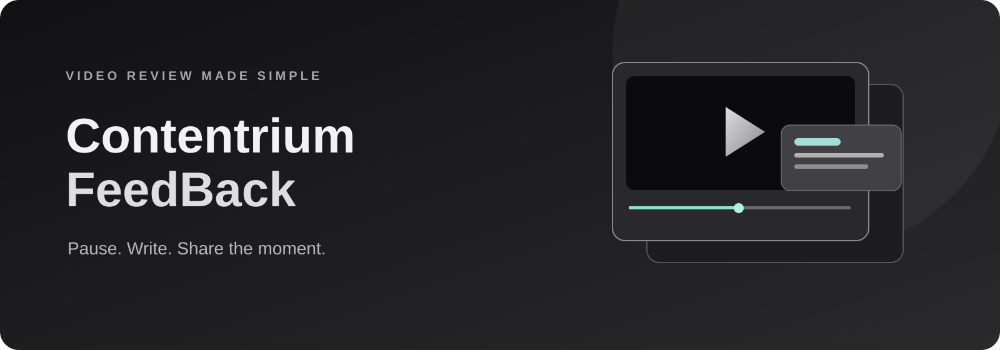
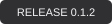
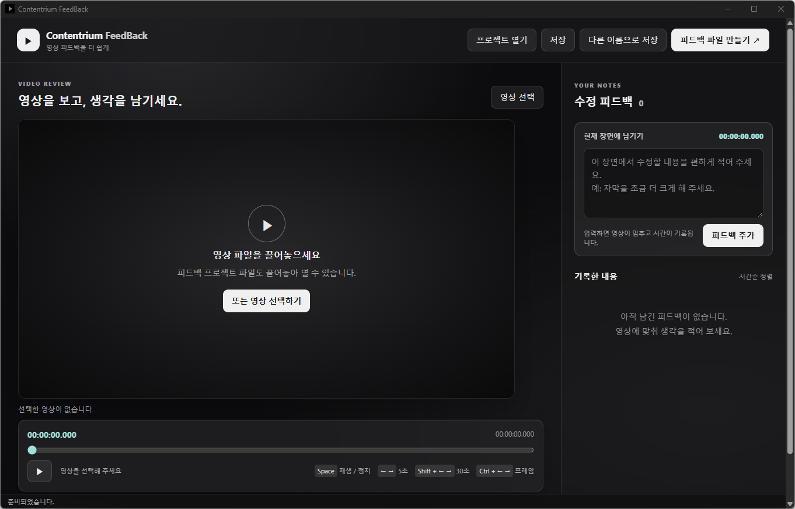

<p align="center"></p>

<h1 align="center">Contentrium FeedBack</h1>
<p align="center"><strong>영상을 멈추고 적으면, 그 순간이 함께 기록됩니다.</strong><br>영상 수정 요청을 시점별로 정리하고 Codex에 전달하는 Windows 프로그램입니다.</p>
<p align="center"><a href="https://github.com/contentriumkorea/Contentrium-FeedBack/releases/latest"></a>  </p>
<p align="center"><a href="#빠르게-시작하기">설치하기</a> · <a href="https://github.com/contentriumkorea/Contentrium-FeedBack/releases/latest">다운로드</a> · <a href="#사용-모습">사용 모습</a> · <a href="#적용-범위와-제한">상세 안내</a></p>

---

## 빠르게 시작하기

Windows 64비트와 Microsoft Edge WebView2가 필요합니다. 설치기는 최신 정식 버전을 확인해 내려받습니다.

[](https://github.com/contentriumkorea/Contentrium-FeedBack/releases/latest/download/Contentrium-FeedBack-Setup.exe)
[](https://github.com/contentriumkorea/Contentrium-FeedBack/releases/latest/download/Contentrium-FeedBack-portable.zip)

## 피드백이 쉬워지는 세 단계

| 01 · 영상 보기 | 02 · 수정 내용 기록 | 03 · 파일로 전달 |
| :--- | :--- | :--- |
| **익숙한 재생 조작** | **시간이 자동으로 기록** | **Codex에 첨부** |
| 스페이스바와 방향키로 재생 위치를 조절합니다. | 입력란에 쓰기 시작한 장면의 시각과 내용을 함께 남깁니다. | 시점별 내용이 정리된 텍스트 파일을 만듭니다. |

## 사용 모습

<p align="center"></p>

**영상과 피드백을 한 화면에서 확인합니다.**

선택한 영상은 원래 위치에 남고, 피드백 시간을 누르면 해당 장면으로 이동합니다.

<details><summary><strong>단축키 보기</strong></summary>

- `Space`: 재생 / 일시정지
- `←` / `→`: 5초 이동
- `Shift` + `←` / `→`: 30초 이동
- `Ctrl` + `←` / `→`: 프레임 이동

</details>

## 설치와 포터블 실행

| 방식 | 사용 방법 |
| :--- | :--- |
| 설치형 | 경량 설치기를 실행하고 설치 화면의 안내를 따릅니다. |
| 포터블 | ZIP을 풀고 실행 파일을 엽니다. |
| 프로젝트 저장 | `.cfeedback` 파일에 기록합니다. 영상 자체는 포함되지 않습니다. |

## 이렇게 사용하세요

```text
영상 파일 끌어놓기 → 재생하다 멈추기 → 수정할 내용 입력 → 피드백 추가
→ 피드백 파일 만들기 → Codex 대화에 파일 첨부
```

## 적용 범위와 제한

영상이나 프로젝트 파일을 창에 끌어놓아 열 수 있습니다. 영상 재생과 프레임 이동은 Windows의 미디어 지원 및 영상 코덱에 따라 달라질 수 있습니다. 파일을 이동하면 프로젝트에서 영상을 다시 연결해야 합니다. 전달용 텍스트에는 영상 경로가 포함되므로 공유 전 내용을 확인해 주세요.

<details><summary><strong>상세 안내와 검증 범위</strong></summary>

설치 후 시작 메뉴 또는 바탕화면에서 실행할 수 있습니다. 프로그램은 프로젝트 파일과 텍스트를 사용자가 선택한 위치에 저장합니다. 서드파티 고지는 배포 파일에 포함됩니다.

</details>
<details><summary><strong>English overview</strong></summary>

Pause a video, write time-linked feedback, and export a text file for a Codex conversation. Local video playback depends on Windows codec support.

</details>

---

<p align="center"><strong>Contentrium</strong><br><a href="https://github.com/contentriumkorea/Contentrium-FeedBack/releases/latest">Latest release</a></p>
<sub>© Contentrium. Third-party notices are included with the distribution.</sub>
<p align="center"><a href="https://contentrium.com/"></a></p>
